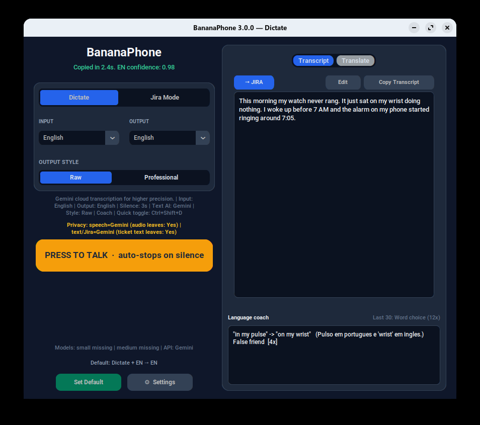
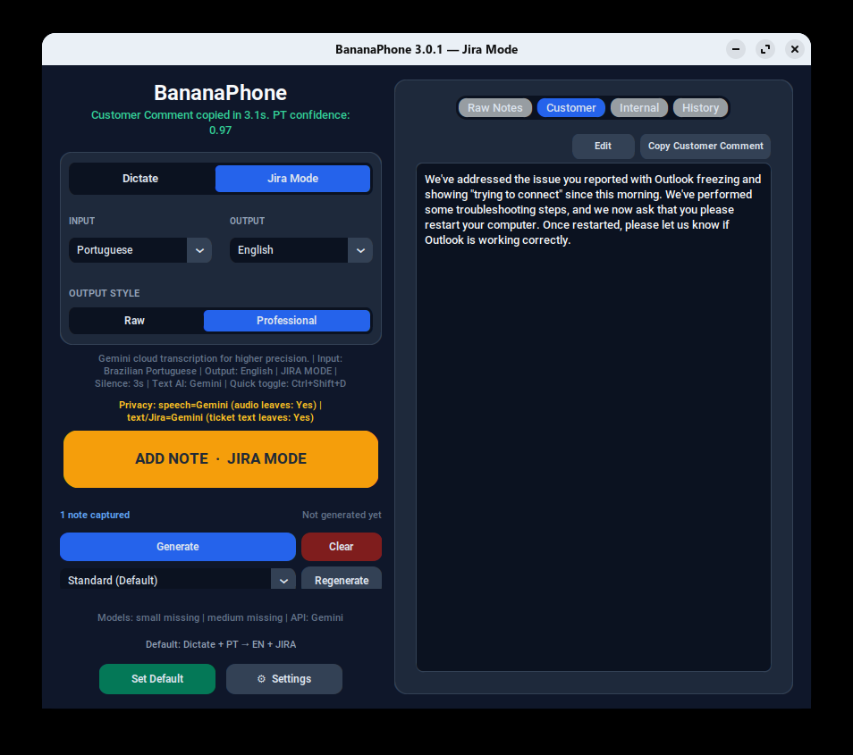

# bananaphone

Desktop dictation app for IT support staff working in a second language: speak Portuguese, Spanish or English, get clean text in any of the three on the clipboard, plus Jira-ready ticket notes and a language coach.

  



## Overview

Writing tickets in a second language usually means juggling a translator, a text editor and the
ticket system for every note. BananaPhone collapses that into one hotkey: speech is transcribed,
translated or polished, and placed on the clipboard. Jira Mode turns rough notes dictated during a
call into a customer-facing reply and an internal worklog in one step. Speech and text processing
can run in the cloud (OpenAI, Gemini) or fully offline (faster-whisper + Ollama), selected per
provider in Settings.

## Features

- Dictate in Portuguese, Spanish or English and copy the result in any of the three, with output style `Raw` (minimal edits) or `Professional` (rewritten for the audience).
- Restyle an existing dictation after the fact; each style is generated once and cached.
- Generate a Customer Comment and an Internal Note from dictated notes in Jira Mode, with selectable profiles (tone, length, sections) and one-click regenerate options (shorter, more technical, more customer-friendly, include follow-up).
- Coach the speaker when dictating in a non-native language: one correction (Simple) or up to four (Advanced), written in the speaker's first language, with a frequency count over the last 30 corrections.
- Translate pasted text (e-mails, chat messages, tickets) while preserving line breaks, IDs, error codes and commands.
- Promote a dictation into Jira Mode with a spoken trigger phrase, the **→ JIRA** button or `Ctrl+Shift+J`.
- Run fully offline with local Whisper (`faster-whisper`, `medium`, CPU int8) and a local Ollama model (`qwen2.5:7b` by default, 14B option); the main window shows live whether audio or ticket text leaves the machine.
- Check GitHub releases on launch and report when a newer build exists.

## How it works

```
 mic --> Speech-to-text                    --> raw text (the language spoken)
         OpenAI /audio/transcriptions             |
         Gemini generateContent (WAV)             v
         faster-whisper (offline)           Text AI  -- style: Raw | Professional
                                                  |
                                 +----------------+----------------+
                                 v                                 v
                              DICTATE                          JIRA MODE
                       polished / translated text            customer reply
                              -> clipboard                  + internal note
                                 |
                                 +--> LANGUAGE COACH  (only when the spoken
                                      raw vs polished   language is not the
                                      -> panel only,    user's first; never
                                      never clipboard   in Jira Mode)
```

- Text tasks use the OpenAI Chat Completions API shape, so any OpenAI-compatible endpoint works: OpenAI, Gemini's OpenAI-compatible endpoint, a local Ollama / llama.cpp / LM Studio server, or a custom URL.
- Gemini has no Whisper-style transcription endpoint, so Gemini speech uses native `generateContent` with the WAV inline. Local providers have no cloud STT, so API-mode speech falls back to OpenAI.
- Gemini 2.5 thinking is capped per task (none for translation, a small budget for Jira) to avoid latency spikes.
- The coach runs on its own thread after the text is already on the clipboard; it cannot delay or break a dictation.
- On the offline path, Jira section structure is enforced deterministically and the Customer Comment is re-derived in a separate jargon-stripping pass so internal tooling does not leak to the end user.
- On Wayland the in-process `pynput` global hotkey listener is disabled (it caused XWayland modifier locks); the Linux installer registers a GNOME shortcut that calls `~/.local/bin/bananaphone-toggle`, which signals the app through `~/.config/bananafone/command.json`.

The single-file app is `bananaphone.py` (CustomTkinter UI). `bananafone.py` is the legacy 1.x app, kept for reference ([README_V1.md](README_V1.md)).

## Requirements

- Windows or Linux (apt, dnf or pacman based distributions for `install.sh`)
- Python 3.10+ (3.13+ supported via `audioop-lts`); `tkinter`, PortAudio and a working microphone
- Python packages in `requirements.txt`: faster-whisper, SpeechRecognition, numpy, PyAudio, customtkinter, pynput
- One of:
  - an OpenAI API key and/or a Gemini API key (cloud), or
  - Ollama for the offline path (installable from Settings or with `--with-ollama`); no key required
- Linux clipboard: `wl-copy` (Wayland) or `xclip` (X11)

## Quick start

Prebuilt Windows installers/portable zips and a Linux AppImage are published on the
[Releases page](https://github.com/cascodigital/bananaphone/releases/latest), each with a `.sha256` checksum.

From source on Linux:

1. Clone the repository:
   ```bash
   git clone https://github.com/cascodigital/bananaphone.git
   cd bananaphone
   ```
2. Install system packages, the virtualenv and the launcher (add `--with-ollama` for the offline path):
   ```bash
   ./install.sh
   ```
3. Start the app, open **Settings**, choose a provider and enter a key (or click **Download offline models**):
   ```bash
   ./.venv/bin/python bananaphone.py
   ```
4. Press `Ctrl+Shift+D`, speak, and paste the result.

From source on Windows: double-click `Install-BananaPhone.bat`, or run `.\install_windows.ps1`
(`-WithOllama` to also install Ollama). The installer picks a PyAudio-compatible Python via winget
if needed and copies the app to `%LOCALAPPDATA%\BananaPhone`. See [README_WINDOWS.md](README_WINDOWS.md).

## Configuration

Most settings live in the in-app **Settings** panel and are stored in `~/.config/bananafone/settings_v2.json`
(the `bananafone` directory name is kept for backward compatibility). Jira history is kept in
`~/.config/bananafone/jira_history.json`, coach statistics in `coach_profile.json`, logs in
`~/.local/state/bananafone/bananaphone.log`.

| Variable / key | Required | Default | Description |
|---|---|---|---|
| AI provider (Settings) | Yes | OpenAI | One selector for speech, translation and Jira text: OpenAI, Gemini, Ollama or custom OpenAI-compatible URL |
| Model / server URL (Settings) | No | per provider | Ollama default `qwen2.5:7b`, server `http://localhost:11434/v1` |
| Output style (Settings) | No | `Professional` | `Raw` or `Professional` |
| Silence timeout (Settings) | No | 3 s | Auto-stop after silence: 3 / 4 / 5 / 8 s |
| My first language (Settings) | No | OS locale | Never coached; language the corrections are written in |
| Coach detail (Settings) | No | Simple | `Simple` (one correction) or `Advanced` (up to four) |
| Polish same-language dictation (Settings) | No | on | Off restores pre-3.0 behaviour (raw transcript pasted as-is) |
| Jira trigger phrases (Settings) | No | `banana jira, gera o jira, gerar o jira, generate jira, make it a ticket` | Spoken phrases that promote a dictation into Jira Mode |
| `OPENAI_API_KEY` | For OpenAI | — | OpenAI key (alternative to entering it in Settings) |
| `GEMINI_API_KEY` / `GOOGLE_API_KEY` | For Gemini | — | Gemini key |
| `BANANAFONE_OPENAI_KEY_FILE` | No | `~/ai/config/ai-keys.md` | Markdown file to read an OpenAI key from; `chaves.txt` next to the script and `~/.config/bananafone/ai-keys.md` are also checked |
| `BANANAFONE_OPENAI_MODEL` | No | `gpt-4o-mini-transcribe` | OpenAI speech model |
| `BANANAFONE_OPENAI_TEXT_MODEL` | No | `gpt-4o-mini` | OpenAI text model |
| `BANANAFONE_GEMINI_MODEL` / `BANANAFONE_GEMINI_TEXT_MODEL` | No | `gemini-2.5-flash` | Gemini speech / text model |
| `BANANAFONE_OPENAI_TRANSCRIPT_URL`, `BANANAFONE_OPENAI_CHAT_URL`, `BANANAFONE_GEMINI_GENERATE_URL` | No | public endpoints | Endpoint overrides |
| `BANANAFONE_MIN_SPEECH_SECONDS` | No | `0.35` | Minimum speech length accepted |
| `BANANAFONE_SILENCE_RMS_MULTIPLIER` | No | `1.35` | Silence detection sensitivity |
| `BANANAPHONE_FORCE_PYNPUT` | No | unset | Force the `pynput` global hotkey listener on Wayland |
| `BANANAPHONE_GITHUB_REPO` | No | `cascodigital/bananaphone` | Repository checked for updates |

## Usage

| Action | How |
|---|---|
| Quick dictation (toggle) | `Ctrl+Shift+D` |
| Send transcript to Jira Mode | `Ctrl+Shift+J`, the **→ JIRA** button, or end the dictation with a trigger phrase |
| Translate pasted text | **Translate** tab, `Ctrl+Enter` |
| Edit generated text before copying | **Edit** toggle on each panel |
| Reuse a past ticket | **History** tab: select, then **Reopen**, **Copy Customer** or **Copy Internal** |



Example: dictated in Portuguese during a call —

> *"cliente reportou que o Outlook está travado em 'Tentando conectar' desde hoje de manhã, verifiquei o painel do Microsoft 365, tudo verde, recriei o perfil do Outlook, limpei as credenciais em cache no Gerenciador de Credenciais e testei pelo Outlook Web, funciona normal por lá, o problema continua só no desktop, pedi pro usuário reiniciar, aguardando confirmação"*

**Customer Comment:**

> We've addressed the issue you reported with Outlook freezing and showing "trying to connect" since this morning. We've performed some troubleshooting steps, and we now ask that you please restart your computer. Once restarted, please let us know if Outlook is working correctly.

**Internal Note:**

> **Issue:** User reported Outlook freezing and showing "trying to connect" since this morning.
> **Investigation:** Checked the Microsoft 365 health dashboard; all services green. Tested Outlook Web Access (OWA), working normally. The issue appears isolated to the desktop application.
> **Actions:** Recreated the Outlook profile. Cleared cached credentials in Credential Manager. Asked the user to restart their machine.
> **Result:** Pending user restart.

Language coach example (English dictated by a Portuguese speaker): *"The watch just stopped in my pulse"* produces

```
"in my pulse" -> "on my wrist"   (Pulso em português é 'wrist' em inglês.)
False friend  [4x]
```

The explanation is written in the speaker's first language; `[4x]` is how often that category
appeared in the last 30 corrections. Release history: [RELEASE_NOTES_3.0.0.md](RELEASE_NOTES_3.0.0.md);
open issues and plans: [FUTURE_RELEASES.md](FUTURE_RELEASES.md).

## Limitations

- Supported languages are Portuguese (Brazilian), Spanish and English only.
- On Wayland there is no in-process global hotkey; `Ctrl+Shift+D` depends on the GNOME shortcut created by `install.sh` (other desktops must bind `bananaphone-toggle` manually).
- A desktop-wide text-selection freeze on Linux/Wayland while the app runs is under investigation (see FUTURE_RELEASES.md).
- The coach is disabled in Jira Mode and only runs when the spoken language differs from the configured first language.
- Offline quality depends on the local model; the 7B model runs on CPU, 14B needs a GPU for usable speed.
- API keys are stored in plain text in the local settings file.

## License

MIT — see [LICENSE](LICENSE).
