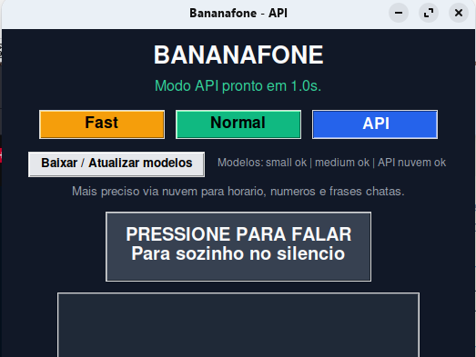

# Bananafone (legacy 1.x)

> Historical documentation for the 1.x app, kept for reference. The current app is
> `bananaphone.py`, documented in [README.md](README.md). The `install.sh` in this
> repository now installs the current app, not this one. The 1.x UI is in Brazilian
> Portuguese; button labels are quoted below exactly as they appear on screen.

Package version: `1.4`

Linux dictation with two local modes and one API mode, designed to stay open on
screen during daily use.

## Overview

`Bananafone` was built for daily desktop use:

- `Fast`: lowest latency for free-form text
- `Normal`: balance between speed and accuracy
- `API`: cloud transcription for better accuracy on numbers, times and awkward phrases

The app stays resident, records when the main button is clicked, stops on its
own after a few seconds of silence, and copies the text to the clipboard.



## Features

- two local modes with `faster-whisper` and one cloud mode with OpenAI
- large single-click button to start speaking
- automatic stop on silence
- `Ctrl+Shift` hold/release shortcut while the window is focused
- `Baixar / Atualizar modelos` (download / update models) button to warm up or download the local cache
- visual cache status for the `small` and `medium` models
- language route selector: `PT -> EN`, `PT -> PT`, `EN -> EN`, `EN -> PT`
- button to save the current mode and route as the new default
- local log at `~/.local/state/bananafone/bananafone.log`

On Linux, the saved default lives in `~/.config/bananafone/settings.json`.

## Limitations

- on GNOME Wayland, `Ctrl+Shift` only works while the `Bananafone` window is focused
- a true global hotkey requires extra integration with the compositor or another daemon

## Requirements

### Python

- Python 3.10+
- `faster-whisper`
- `SpeechRecognition`
- `numpy`
- `PyAudio`

### System binaries

- `ffmpeg`
- `wl-copy` or `xclip`
- `python3-tk`

### API key

`API` mode uses the OpenAI transcription API. The app looks for the key in this order:

1. the `OPENAI_API_KEY` environment variable
2. the file set in `BANANAFONE_OPENAI_KEY_FILE`
3. local fallbacks: `~/ai/config/ai-keys.md`, then `~/.config/bananafone/ai-keys.md`

To change the `API` mode model, set `BANANAFONE_OPENAI_MODEL`.
The current default is `gpt-4o-mini-transcribe`.

The default route is `PT -> EN`: you speak Brazilian Portuguese and get English
text. The `PT -> EN` and `EN -> PT` routes also use an OpenAI text model to
convert the transcription. To change that model, set
`BANANAFONE_OPENAI_TEXT_MODEL`. The current default is `gpt-4o-mini`.

### Where to put the key

Simplest way:

1. open `~/.config/bananafone/ai-keys.md`
2. add a line like this:

```md
- **OpenAI (Speech):** `your-key-here`
```

Alternatives:

- export `OPENAI_API_KEY` before starting the app
- point `BANANAFONE_OPENAI_KEY_FILE` at another file

If an `OpenAI (Speech)` entry exists in `ai-keys.md`, `Bananafone` uses it
automatically.

## Compatibility

`Bananafone` should work on GNOME or KDE if the machine has:

- Python with `tkinter`
- a working microphone via PulseAudio or PipeWire
- `wl-copy` on Wayland or `xclip` on X11 for the clipboard

On KDE the odds are good, since the app is plain Tkinter and depends on nothing
GNOME-specific.

Things to watch:

- on Wayland, the `Ctrl+Shift` shortcut still requires the window to be focused
- the menu launcher relies on `~/.local/share/applications`, which is standard on KDE too
- if the clipboard fails, it is usually a missing `wl-copy` or `xclip`, not the app itself

## Installation

### Manual installation

```bash
python3 -m venv .venv
source .venv/bin/activate
pip install -r requirements.txt
```

### Windows

The Windows port is documented in [`README_WINDOWS.md`](README_WINDOWS.md).

In 1.x, `API` mode used `OPENAI_API_KEY` or an `ai-keys.md` file at
`%USERPROFILE%\.config\bananafone\ai-keys.md`.

## Quick use

```bash
./.venv/bin/python bananafone.py
```

Flow:

1. open the app
2. the default mode is `API`
3. the initial default route is `PT -> EN`
4. pick `PT -> PT`, `EN -> EN` or `EN -> PT` for another route
5. switch to `Fast`, `Normal` or `API` depending on the machine
6. to make the combination the new default, click `Tornar atual o padrao` (make current the default)
7. click the main button to speak
8. wait for it to stop on silence, or click again to finish
9. paste the text wherever you want

## Desktop entry

[`desktop/bananafone.desktop`](desktop/bananafone.desktop) is kept as a reference.

## Development

Syntax check:

```bash
python -m py_compile bananafone.py
```

## Notes

On the first run of the local modes, `faster-whisper` may download the model and
warm up the local cache; the `Baixar / Atualizar modelos` button exists for exactly
that. `API` mode does not use the local Whisper cache; it sends the captured audio
to the configured transcription API. The `PT -> PT` and `EN -> EN` routes copy the
transcription directly. The `PT -> EN` and `EN -> PT` routes go through an OpenAI
conversion before copying.
